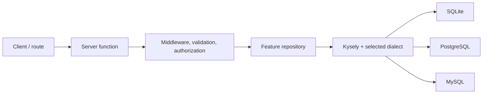
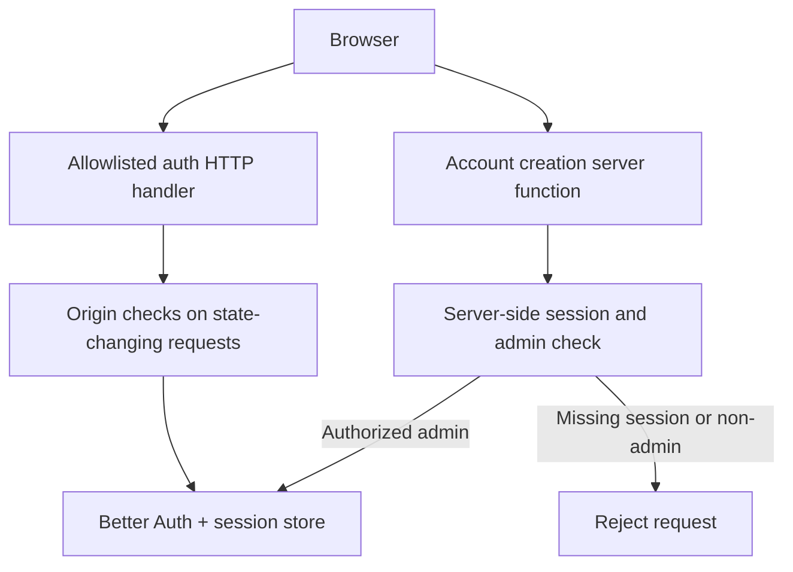

# Architecture

## Baseline

Modular monolith: one TanStack Start application, one repository, SQLite by default, optional PostgreSQL or MySQL, Bun 1.4.2, and the Nitro `bun` preset. Bun (pinned in `.bun-version` and `packageManager`) manages dependencies and runs the application in development, builds, and production. Commit `bun.lock` and use frozen installs in CI. Node 26 is not the application runtime; it is retained for the current test tooling and policy-test runner.

The main backend flow is:



This is a dependency overview, not a claim that every request uses every component. Authentication also has a restricted HTTP handler described below.

```text
client/loader
  -> TanStack server function
  -> request middleware + TanStack schema validator
  -> domain repository
  -> Kysely query builder and dialect
  -> SQLite, PostgreSQL, or MySQL
```

Server functions are endpoints and must validate input and enforce authorization. Never trust input, tenant IDs, or roles sent by the client. The pinned TanStack Start version provides default CSRF middleware for server functions; do not disable it. Better Auth is configured lazily and has a restricted HTTP route with explicit origin checks. Public signup and OAuth are disabled.

### Authentication boundary



The HTTP handler allows only selected sign-in, session, sign-out, and password-change endpoints. Account creation uses a separate server function; public registration and direct admin endpoints are not exposed. See `src/modules/auth/auth-http.server.ts` and `src/modules/auth/auth.functions.ts` for the authoritative implementation.

## Backend core

`src/server/` contains small, clearly named infrastructure boundaries shared across domains:

- `env.server.ts`: the only application boundary that reads `process.env`; parses raw strings into typed, camelCase configuration and caches the result.
- `errors.ts`: a client-safe application error contract with shared kinds (`invalid_argument`, `not_found`, `conflict`, `unauthorized`, `forbidden`, `rate_limited`, `internal`) and stable domain/application codes.
- `logger.server.ts`: structured JSON logging without raw payloads or secrets.
- `request.ts`: import-safe TanStack middleware and `RequestResult` conversion; its `.server()` callback dynamically loads the executor so server-only logging does not enter the client graph.
- `request.server.ts`: request ID, timing, structured error logging, and error normalization. Validators use `.validator((input) => schema.parse(input))` so Zod errors can be normalized consistently.
- `portable-database.server.ts`: Kysely dialect composition for SQLite, PostgreSQL, and MySQL. Provider-specific drivers stay server-only.

This core is not a generic service framework. Do not add `BaseRepository`, `Manager`, `Processor`, or other layers without a concrete need.

## Boundaries

- Domain: `src/modules/<domain>/domain` contains pure rules, input and row/result schemas, and domain types. It does not import React, TanStack, databases, process/environment, filesystems, or network APIs.
- Server-only repositories (`*.server.ts`): own parameterized, domain-specific queries using Kysely with an explicit schema type and validated rows. Do not expose driver result types or raw database error codes.
- `*.functions.ts`: transport boundary. Attach request middleware, validate with the domain schema using `.validator((input: unknown) => schema.parse(input))`, enforce policy/authorization, compose dependencies, and delegate. Do not read `process.env` or use `pg` directly here.
- Routes: presentation and user interaction; no SQL or server-only infrastructure.
- Migrations: explicit, versioned, and immutable after application. Each supported provider uses its own subdirectory under `db/migrations/` (`sqlite/`, `postgres/`, and `mysql/`); equivalent migrations use matching filenames and one statement per file, with provider-specific SQL. MySQL DDL can commit independently; failed or interrupted attempts require manual recovery. Auth migrations are included but never run at application startup.

Dependencies point inward. UI and transport may depend on domain contracts and server functions. Repositories may depend on domain types and the shared database abstraction. Domain code does not depend on infrastructure.

## Errors and request handling

Expected failures use a stable `AppError` kind and code. The kind is generic for transport and observability; the code may be domain-specific, such as `DUPLICATE_CODE`. Map known database constraints near the query that understands their meaning; translate raw PostgreSQL codes once in the adapter. Unexpected failures continue to the request boundary, are logged and normalized to `internal`, and do not expose internal details to users.

Do not add `try/catch` blocks to every repository or server function just to repeat logging or error mapping. Catch locally only when that scope can recover, translate a specific meaning, or perform cleanup not handled by the core.

## Environment

Application server code uses `getEnv()` instead of repeatedly reading `process.env`. Test harnesses, build configuration, scripts, and process launchers may read or set environment variables directly because they are outside the application runtime boundary.

## Production decisions required

Review the Better Auth session and account-provisioning model, tenant boundary, business authorization, runtime database roles, logging/audit sink, rate limits, backup/restore procedures, and deployment model. Production must use separate application and migration roles. Row-level security is not implemented.

Structured console logging is a baseline, not a production observability stack. A production sink can replace the logger at the shared boundary without changing feature repositories.

## ADRs

Use `docs/adr/0000-template.md` for decisions that cross modules or are expensive to reverse. Record alternatives and consequences, not only the chosen option.
