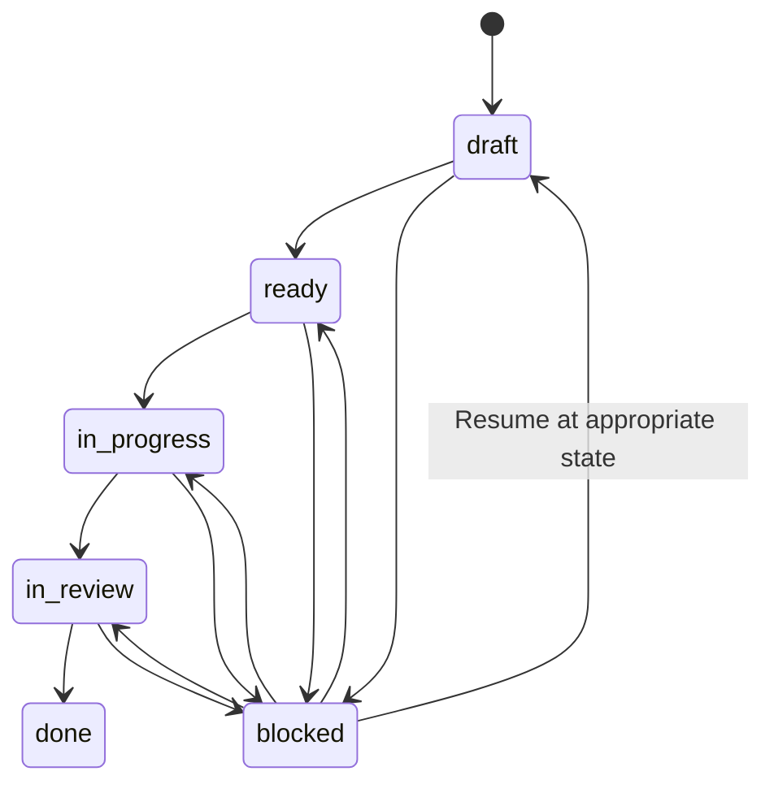

# Single-project workflow

## Sources of truth

Code and repository documentation describe the current system. Issues capture requests and discussion; pull requests capture changes and evidence. Use `docs/tasks/TEMPLATE.md` to create a versioned local task when GitHub is unavailable. Link these records instead of duplicating information that will quickly go stale.

## Task states

`draft` → `ready` → `in-progress` → `in-review` → `done`; use `blocked` when a decision or access prevents progress. A task status is a record, not an enforcement mechanism. `ready` means the acceptance criteria are clear enough and the user has authorized that scope.



Diagram labels use underscores because Mermaid state identifiers cannot use the hyphenated task names directly. Returning from `blocked` depends on the task's actual state; these labels do not enforce transitions.

| Work mode | Main outcome | Do not assume |
| --- | --- | --- |
| Plan | Accepted scope and recorded acceptance criteria | Planning authorizes implementation |
| Implement | Working change and actual verification evidence | Passing tests authorize a merge or deployment |
| Review | Prioritized findings with evidence | Review authorizes silent implementation |

## Default path for natural-language requests

The user may simply describe an outcome, such as "Let an administrator export their own account data" or "Fix the account form error." The agent handles routine workflow steps without asking for each one. These are instructions to coding agents, not a background service, GitHub Project board, or permission to take external actions beyond the request.

1. **Route the request.** A question gets an answer; "plan/design only" produces a plan without application changes; "review" reports findings without fixes. A clear request to build/fix/refactor authorizes the corresponding reversible work. Read `AGENTS.md`, product/domain context, Git status, the nearest implementation, and the relevant runbook. A user's "do it" is not a substitute for undecided business rules.
2. **Establish the task.** Reuse a matching issue or task; otherwise prefer a real same-repository issue when GitHub access is available, or create a local `docs/tasks/` record when it is not. Use both only when a durable local plan adds value, and link them instead of duplicating details. Write the goal, numbered acceptance criteria, risk, verification, compatibility, and any material unknowns before changing application behavior. Use `draft` while clarifying; move to `ready` only when the authorized scope is clear. If GitHub is unavailable, keep truthful local links (`not-created`) and continue authorized work where possible.
3. **Work without extra ceremony.** For implementation, create/use one task branch from the appropriate base (not `main`), mark `in-progress`, implement the smallest complete change, add relevant tests, and run the checks. Ask about decisions affecting data, money, access, scope, or external side effects before acting on them. Do not create duplicate issues, overwrite user changes, or request routine approval again. A plan-only or review-only request stops before this step.
4. **Prepare review.** Record the tested revision, actual command results, failures, and limitations in the task. Inspect the final diff and sensitive paths, verify the PR body with the trusted-base `scripts/check-pr.mjs`, and create a PR using `.github/PULL_REQUEST_TEMPLATE.md` if access and authorization exist. Only then mark `in-review`; if a PR cannot be created, provide a local handoff rather than a fabricated link. Git hooks and self-reported local results are not hosted CI or independent approval.
5. **Finish only when appropriate.** Respond to review feedback on the same branch; re-run affected tests after changes. Merge, deployment, production migration, payment, destructive cleanup, and similar external/irreversible actions require action-specific authorization. After a PR is actually merged, mark the task `done` and report the outcome: a linked `Closes #...` issue closes on merge, while a local task needs a separate follow-up change on a branch (never an unreviewed direct edit to `main`). If a decision/access blocks progress, record `blocked` with the next action instead.

For example, "Fix the account form error" authorizes investigation, a regression test, the fix, local verification, and a reviewable PR without the user spelling out those steps. "Plan how to fix the account form error" stops after a plan. "Deploy the fix" is a separate action that requires a specific target and authorization. Agents may use a GitHub Project board if one is configured, but this repository does not require one.

## Planning

1. Read the product/domain context, related code, Git status, and relevant tests.
2. Define the outcome, scope, invariants, numbered acceptance criteria, risks, steps, and verification.
3. Ask only about material choices. Record routine assumptions.
4. Create a GitHub issue or a local task from the template as appropriate. Reuse a matching record before creating another; create both only when a local plan adds value and link them. Record the plan revision and source of authorization; never invent approval.
5. Update the plan when material scope changes. Earlier authorization does not automatically apply to new scope.

## Implementation

1. Keep one task per branch and preserve existing user changes.
2. Implement a small, testable slice. Tests must prove expected behavior and important failure cases.
3. Run `bun run check` and relevant database/browser checks. For database-backed full-stack changes, run `bun run verify` when the disposable test prerequisites are available.
4. Update domain, ADR, or runbook documents when behavior or the architecture contract changes.
5. Record actual commands, results, limitations, and the revision tested. Explain failures; do not weaken tests.
6. Use the commit format in `docs/COMMITS.md`. Keep unrelated changes in separate commits.
7. Before opening a pull request, read `.github/PULL_REQUEST_TEMPLATE.md` and `scripts/check-pr.mjs`, then inspect the final changed-file list against the verifier's sensitive-path rules.
8. Use the repository pull request template. Link a real issue with `Closes #123`, set `Risk: low|medium|high` based on the actual diff, and complete every verified section: Goal, Changes, Verification, Compatibility and recovery, and Documentation.
9. If the verifier classifies any changed path as sensitive, use `Risk: high` and follow the repository review policy. Never lower the risk or change the verifier to get a passing result.

## Commits

Use Conventional Commits as described in `docs/COMMITS.md`:

```text
<type>(<scope>): <description>
```

Examples:

```text
feat(auth): add password reset flow
fix(api): reject malformed pagination cursor
refactor(domain): extract order pricing policy
docs: clarify local setup
```

Mark breaking changes with `!` or a `BREAKING CHANGE:` footer. AI agents follow the same rules and must not put prompts, secrets, or user data in commit messages.

## Review and merge

Run the PR verifier locally to check metadata structure and some sensitive paths. Reviewers check substance, acceptance criteria, tests, and domain impact. There is no GitHub Actions CI or automatic approval, auto-merge, or deployment. Local results are self-reported and do not provide an independent gate.

`scripts/check-pr.mjs` is the executable metadata contract, retained for local use. The pull request template is the starting point; check the body and changed-file list against the verifier from the trusted base revision before submitting. The CLI entry point expects `GITHUB_EVENT_PATH` with a pull-request event and both base/head revisions available locally; its `validatePr(body, files)` export can be used for a local check. Record the result and tested commit on the PR. If the contract fails, correct the metadata or scope; do not bypass the verifier.

Repository owners should configure the GitHub protections available to them and remove any required checks that no longer run. If you are the only human contributor, see the solo workflow in `docs/GITHUB_SETUP.md`; do not add a fake reviewer to satisfy a rule.

## Handoff

Before switching sessions, fill in `docs/HANDOFF.md` with the task, branch, latest commit, uncommitted files, test results, blockers, and next step. Do not store secrets or a full chat transcript.

## Definition of done

Acceptance criteria are met and supported by evidence, changes stay in scope, relevant checks are complete or blockers are explicit, documentation is accurate, and issues/pull requests are linked when available. If GitHub is unavailable, report that external work as pending rather than claiming an issue or pull request exists.
